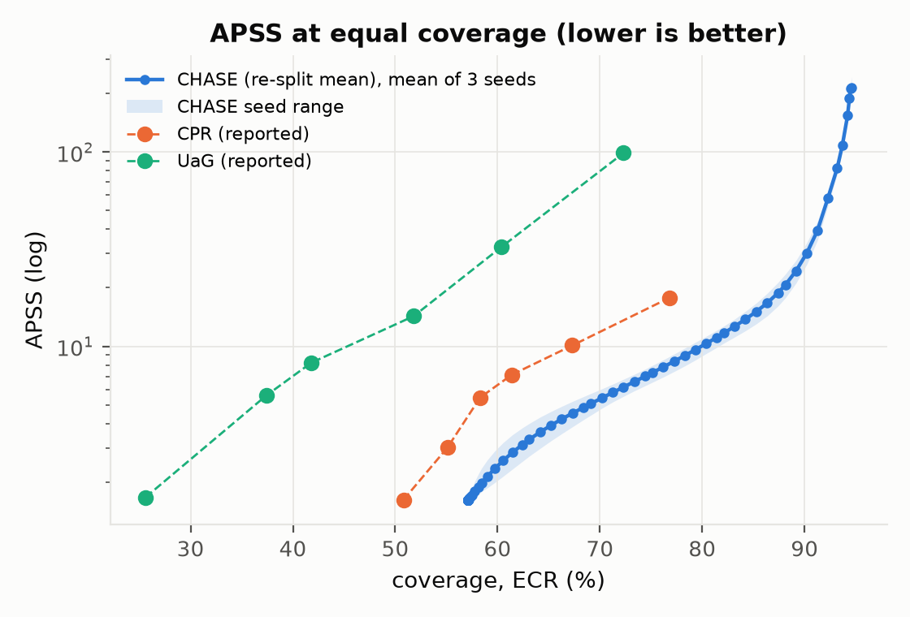
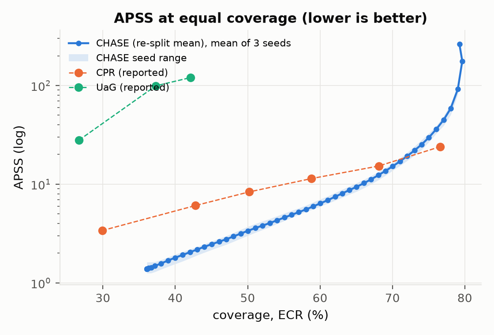
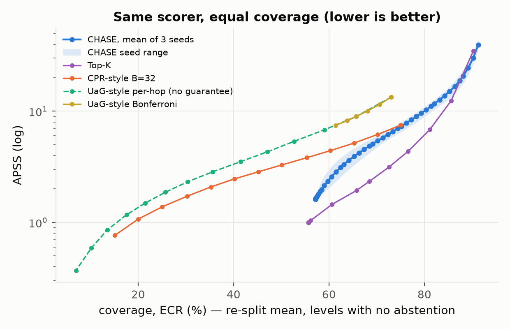
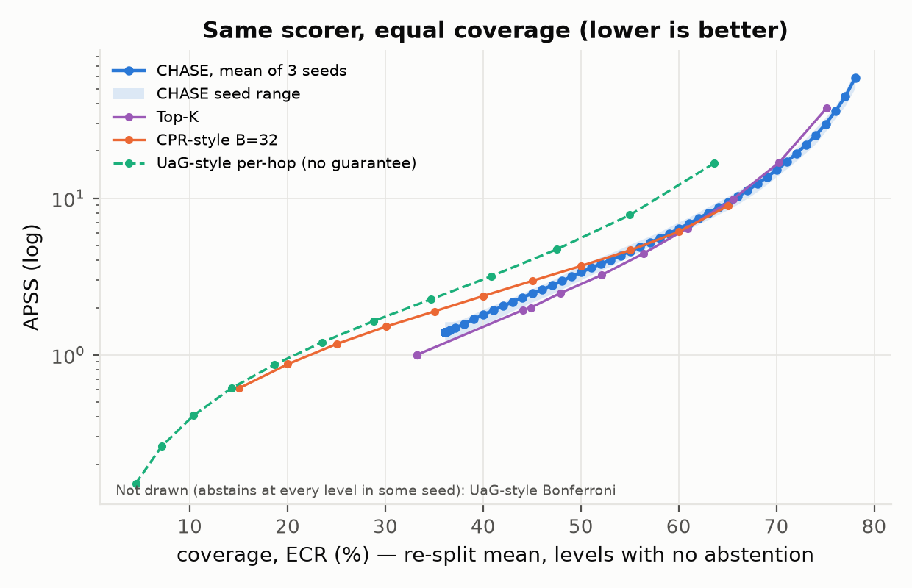

<div align="center">

# CHASE

### Conformal Heuristic Search with Exact Coverage<br>for Multi-hop Evidence Retrieval on Knowledge Graphs

*Prune inside the search with one calibrated threshold, and return an answer set that contains a correct answer with probability ≥ 1 − α: valid, tight, and LLM-free.*


</div>

> **Status (31 Oct 2026).** The full pipeline (graphs → scorer → bottleneck DP → conformal calibration → two-stage training → official evaluation) is implemented and tested. Results on **WebQSP** and **CWQ** (3 seeds each), the comparison with reported CPR / UaG and the same-scorer baselines are in [`docs/results.md`](docs/results.md). BioHopR is in progress.

---

## Contents

[Motivation](#motivation) · [Method](#method) · [Results](#results) · [Benchmarks](#benchmarks) · [Repository layout](#repository-layout) · [Setup](#setup) · [Reproducing](#reproducing-the-results) · [Testing](#testing) · [Roadmap](#roadmap)

---

## Motivation

Missing a drug–target or drug–drug interaction is a safety failure, not a lower score. Retrieval for such settings needs a **guarantee**, not a good average. Existing conformal KGQA methods compromise:

| Method | Where the threshold acts | Guarantee | Limitation |
|---|---|---|---|
| UaG (AAAI 2025) | Inside beam search; one threshold per hop | Per-hop calibration breaks exchangeability | Coverage can fail; Freebase only |
| CPR (arXiv 2605.08077) | Post-hoc filter after a fixed beam (TreeG 32×32) | Valid, but conservative; ignores τ̂ = ∞ | Coverage capped by beam recall; one LLM call per question |
| **CHASE** | **Inside the search, one exchangeable score per question** | **Valid and tight:** 1 − α ≤ coverage ≤ 1 − α + 1/(n+1) | Capped only by KG reachability ρ_H |

## Method

```
question + topic entities ─► state-based scorer ─► bottleneck DP, pruned at τ̂ ─► answer set + evidence walks
                                                   (σ_v ≤ σ_min(q) + τ̂)       ▲
              calibration set ─► unpruned DP ─► g*(q) = σ*(q) − σ_min(q) ─► conformal quantile ─► τ̂
```

1. **State-based scorer.** A step head scores each expansion (hop $h$, relation $r$, node $v$); a stop head scores returning $v$ at hop $h$. Each head is $\mathrm{MLP}([q;r;h]) + \langle P(q,h), Q(v)\rangle$ with frozen MiniLM inputs, and the nonconformity is $s=\mathrm{softplus}(-\text{logit})$. The logit is additive, so scoring any edge is a table lookup: 1M edges in 37 ms.
2. **Max-prefix score.** Irreversible pruning keeps a walk iff every step scores ≤ τ, so a walk's cost is its worst step.
3. **Bottleneck DP.** $b_h(v)=\min_{u\to v}\max\{b_{h-1}(u),\,s_h(q,r,v)\}$ gives, for every node, $\sigma_v$ = the smallest threshold at which the search returns $v$. It is exact, takes $O(H(|V|+|E|))$, and needs no beam or hard cap.
4. **Calibration on the gap.** $\sigma^*(q)=\min_{a\in A_q}\sigma_a$ is the smallest threshold at which the search finds a correct answer, and $\sigma_{\min}(q)$ is the score of the most confident candidate. CHASE calibrates the gap $g^*(q)=\sigma^*(q)-\sigma_{\min}(q)$ and returns $\{v:\sigma_v\le\sigma_{\min}(q)+\hat\tau\}$. $\sigma_{\min}$ uses no labels, so $g^*$ is still one exchangeable score per question and coverage is exact. Measuring every question from its own best candidate makes one threshold comparable across questions; the most confident candidate is always returned, so coverage cannot fall below about Hit@1. The pruned search uses the best candidate found so far as an upper bound on $\sigma_{\min}$ and returns exactly the unpruned set. Levels above the KG ceiling are reported as **infeasible**.
5. **Two-stage training.** Stage 1 trains a BCE loss on steps and stops, with labels from filtered gold paths. Stage 2 extends ConfTr to graph search: a soft bottleneck DP plus a differentiable quantile on half a batch, minimising the soft number of *wrong* answers within the calibrated gap on the other half.
6. **Type feasibility (typed KGs)** and **conformal risk control** for multi-answer recall are implemented for the biomedical benchmark.

Full method and proofs: [`proposal_chase.tex`](proposal_chase.tex). The coverage theorem with unreachable questions, abstention, ties and multi-answer targets: [`theory.tex`](theory.tex).

## Results

3 seeds per dataset, H = 2, commit `debca94`. Full tables, coverage checks and sources for every number: [`docs/results.md`](docs/results.md).

**Coverage is on target.** Over 1,000 re-splits of cal and test, mean ECR equals 1 − α to within 0.5 points on both datasets. On the official split, CWQ is on target; WebQSP, with only 283 cal questions, is on average 1–2 points below, inside the theory interval. Coverage cannot fall below a floor of about Hit@1 (56.7% WebQSP, 36.5% CWQ), and CWQ abstains at α ≤ 0.1 because of its reachability ceiling (0.80).

**Equal coverage vs reported numbers.** APSS ratio CHASE / other (< 1: CHASE smaller):

| | WebQSP | CWQ |
|---|---|---|
| CPR (reported) | 0.40–0.47 at 58–77% | 0.35–0.82 at 43–68%; **1.71 at 77%** (near the ceiling) |
| UaG (reported) | 0.06–0.08 at 60–72% | 0.02 at 37–42% |

**Same scorer.** With every method on the trained CHASE scorer:
- CHASE beats UaG-style per-hop and Bonferroni (1.6–2.9× smaller sets) and fixed beams with post-hoc filtering at B ≥ 32 at almost every level.
- Beams lose answers. B = 8 / 32 / 128 reaches a gold answer for 77 / 86 / 92% of WebQSP and 53 / 67 / 76% of CWQ questions, against 95% and 80% for CHASE.
- **Conformal top-K is smaller at mid coverage** (up to 2.1× on WebQSP at 66–81%), and CHASE is smaller at high coverage (≥ 90% WebQSP, 80% CWQ).

| | |
|---|---|
|  |  |
|  |  |

The pruned search returns exactly the unpruned set on every test question, visits 3–27× fewer DP states, and takes about 7 ms per question on a laptop CPU.

## Benchmarks

| Dataset | Searchable KG | Role | Test | Answer in graph | ρ₁ | ρ₂ |
|---|---|---|---|---|---|---|
| WebQSP (RoG) | Freebase, one subgraph per question | Direct comparison with UaG / CPR | 1,628 | 95.64% | 66.28% | **95.33%** |
| CWQ (RoG) | Freebase, one subgraph per question | Direct comparison, compositional | 3,531 | 80.66% | 43.95% | **80.12%** |
| BioHopR | Full PrimeKG (134k nodes, 4.1M edges) | Biomedical, multi-answer (36.65 answers / question) | own split | — | — | — |

ρ_H is the share of questions with a gold answer reachable within H hops: an upper bound on coverage for **every** method. It stops growing at H = 2, because RoG subgraphs are 2-hop neighbourhoods.

## Repository layout

```
chase/
  kg/          graph.py (CSR KG) · build_primekg.py · build_freebase.py · subgraphs.py · type_distance.py
  model/       text_cache.py (frozen MiniLM) · features.py · scorer.py (StateScorer, BoundScorer, ScoreTables)
  search/      dp.py (bottleneck DP, evidence walks, rho_H)
  conformal/   split.py (split CP, CRC) · calibrate.py (calibration scores from the DP)
  data/        splits.py · gold_paths.py (path enumeration + coincidental-path filter)
  train/       losses.py (BCE, soft DP, ConfTr) · sampler.py · train.py · evaluate.py
  eval/        freebase.py (official evaluation) · compare.py (multi-seed, same α / equal coverage) · plots.py · reference.py (published baselines)
  baselines/   same-scorer baselines: conformal top-K · CPR-style beam · UaG-style per-hop
tests/         261 unit tests
docs/          results.md (all results and their sources) · baselines.md (how UaG, CPR, top-K and CHASE build their sets) · figures/
proposal_chase.tex · theory.tex · requirements.txt
```

## Setup

```bash
python3.11 -m venv .venv && source .venv/bin/activate
pip install -r requirements.txt
hf download sentence-transformers/all-MiniLM-L6-v2 --local-dir models/all-MiniLM-L6-v2 \
  --include "*.json" "*.txt" "model.safetensors" "1_Pooling/*"
```

Raw data goes under `data/raw/` (git-ignored): PrimeKG `kg_giant.csv` (Harvard Dataverse), RoG-WebQSP / RoG-CWQ (Hugging Face `rmanluo/*`), BioHopR (Hugging Face `knowlab-research/BioHopR`).

## Reproducing the results

WebQSP end to end. Times are for an Apple-silicon laptop, CPU only.

```bash
D=data/processed/webqsp
python -m chase.kg.build_freebase --raw data/raw/rog_webqsp --out $D          # subgraphs          ~40 s
python -m chase.model.text_cache freebase $D                                  # MiniLM cache       ~3 min
python -m chase.data.splits --data $D                                         # train/cal/val/test
python -m chase.data.gold_paths --data $D --split train --H 2                 # training labels    ~6 s
for s in 0 1 2; do
  python -m chase.train.train --data $D --out runs/webqsp_seed$s --seed $s    # two-stage training ~10 min
  python -m chase.eval.freebase --data $D --model runs/webqsp_seed$s/best.pt \
                                --out runs/webqsp_seed$s/eval                 # evaluation         ~2 min
done
python -m chase.eval.compare --evals runs/webqsp_seed{0,1,2}/eval --out runs/webqsp_compare
```

For CWQ, replace `webqsp` with `cwq`, and make two other changes:
- split with `chase.data.splits --data $D --cal-from validation`;
- pass `--alpha 0.3` to training and `--main-alpha 0.3 --dataset cwq` to evaluation.

CWQ training takes about 1.5 h per seed.

The evaluation writes these files to the `--out` folder:
- `results_table.md`, `results.csv` and `metrics.json`;
- `validity.json`, with 1,000 re-splits;
- `matched.json`, with the equal-coverage points;
- `per_question.parquet`;
- seven figures (PNG + PDF).

`compare` writes `compare.md` and the same-α and equal-coverage figures.

Same-scorer baselines, per seed and then over seeds:

```bash
for s in 0 1 2; do
  python -m chase.baselines.run --data $D --model runs/webqsp_seed$s/best.pt \
                                --out runs/webqsp_seed$s/baselines --beams 8 32 128
done
python -m chase.baselines.report --runs runs/webqsp_seed{0,1,2}/baselines --out runs/webqsp_baselines
```

Biomedical graph (PrimeKG):

```bash
python -m chase.kg.build_primekg --csv data/raw/primekg/kg_giant.csv --out data/processed/primekg_full
python -m chase.model.text_cache primekg data/processed/primekg_full
python -m chase.kg.type_distance --kg data/processed/primekg_full
```

## Testing

```bash
python -m pytest tests -q        # 261 tests, ~10 s
```

The key invariants are checked against brute force: the DP's σ equals enumeration of every walk; a pruned search returns exactly the unpruned answer set; the soft DP converges to the hard DP as T → 0; split-conformal and CRC thresholds meet their guarantees in simulation; `bind()` lookup tables equal the full forward pass.

## Roadmap

- [x] Full PrimeKG graph; WebQSP / CWQ subgraph stores; MiniLM caches
- [x] State-based scorer, type feasibility, bottleneck DP, reachability ceilings
- [x] Conformal calibration (split CP, CRC)
- [x] Gold paths, sampler, two-stage training (BCE + conformal training)
- [x] Official evaluation, 1000-re-split validity check, figures
- [x] WebQSP / CWQ results, 3 seeds each
- [x] Same-α and equal-coverage comparison with reported CPR / UaG; theory note
- [x] Same-scorer baselines: per-hop (UaG-style), Bonferroni, fixed beam + post-hoc (CPR-style), conformal top-K
- [ ] Paired bootstrap
- [ ] BioHopR (entity linking, CRC); CPR re-run under identical conditions
- [ ] Ablations RQ6; paper

## Citation

Paper in preparation. Please contact the authors before citing.

## License

To be decided before public release.
