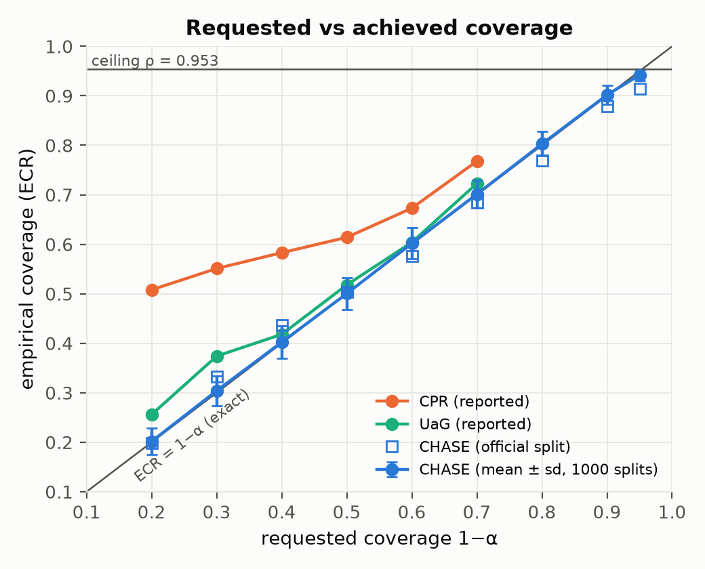
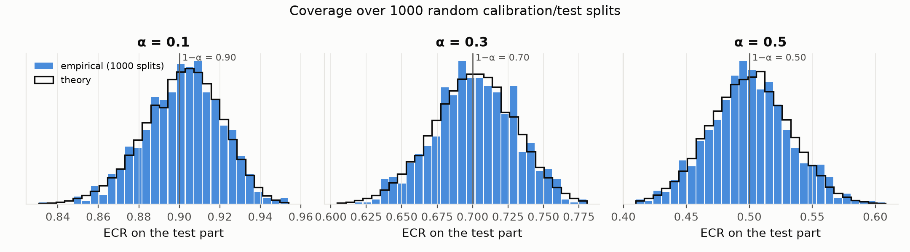
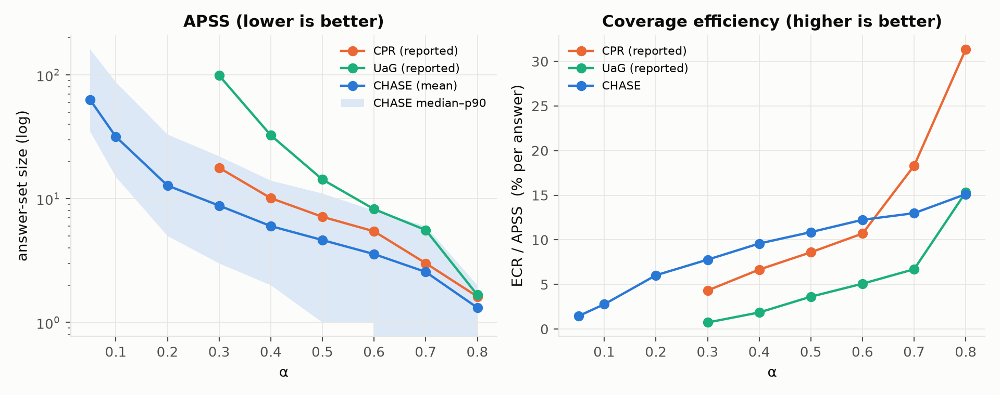
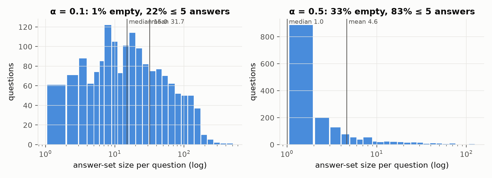
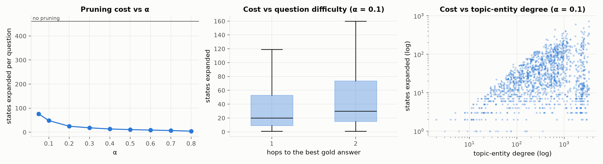
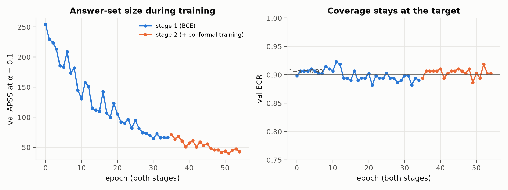

# Báo cáo tiến độ: CHASE, kết quả đầu tiên trên WebQSP

**Thời gian:** tuần 13/10 – 17/10/2026 · **Dự án:** CHASE (Conformal Heuristic Search with Exact Coverage) · **Báo cáo đầu tiên kể từ khi đổi hướng từ MedMIG-CR**

---

## 1. Tóm tắt

- Đã hoàn thành **toàn bộ pipeline end-to-end** của CHASE: graph, scorer, bottleneck DP, hiệu chỉnh conformal, train hai giai đoạn, đánh giá chính thức. 148 unit test, tất cả đều đạt.
- **Kết quả đầu tiên trên WebQSP** (1 seed, split giống CPR: 283 câu cal / 1,628 câu test):
  - **Đảm bảo coverage đúng và chặt.** Qua 1000 lần chia lại cal/test, ECR trung bình khớp lý thuyết tới 3 chữ số (ví dụ α = 0.1: 0.902 so với lý thuyết 0.901). CPR thì phủ **vượt** mục tiêu từ 7 tới 31 điểm phần trăm, tức thủ tục của họ bảo thủ.
  - **CHASE đạt được α = 0.1 và 0.2** (ECR 87.9% và 77.0%), là các mức CPR và UaG **không báo cáo**.
  - **Ở vùng coverage cao (≥ 65%), CHASE cho tập đáp án nhỏ hơn CPR 16–29%** khi so ở cùng mức coverage. **Ở vùng coverage thấp (≤ 60%), CPR tốt hơn.** Đây là điểm yếu cần xử lý.
  - **Tốt hơn UaG ở mọi mức α**, khoảng 3–11 lần về kích thước tập.
  - **Chi phí:** 6.4 ms mỗi câu trên **một luồng CPU, không cần LLM**. Search có cắt chỉ duyệt khoảng 48 trạng thái mỗi câu ở α = 0.1, so với 462 nếu không cắt (khoảng 10 lần ít hơn).
  - **Conformal training (giai đoạn 2) giảm APSS 38.7%** trên val, qua cổng G5 (≥ 15%).

---

## 2. Bối cảnh: vì sao đổi hướng

**Hướng cũ (MedMIG-CR):** chẩn đoán trên DDXPlus bằng MIND kết hợp beam search trên PrimeKG. Bị dừng vì encoder có giám sát đã đạt MRR 0.99 mà không cần search, còn PrimeKG gần như không mang tín hiệu chẩn đoán cho các bệnh của DDXPlus (các tín hiệu chỉ từ KG chỉ ngang mức ngẫu nhiên).

**Hướng mới (CHASE):** truy xuất bằng chứng nhiều bước trên KG **có đảm bảo thống kê**:
```
P( tập đáp án chứa ít nhất một đáp án đúng ) ≥ 1 − α      (đúng với mẫu hữu hạn, không giả định phân phối)
```
Trong các phương pháp thoả đảm bảo này, phương pháp nào cho **tập đáp án nhỏ hơn** và **search rẻ hơn** thì tốt hơn. Động cơ y sinh: bỏ sót một tương tác thuốc là lỗi an toàn, nên cần đảm bảo, không chỉ cần "trung bình tốt".

---

## 3. Phương pháp

```
Câu hỏi + thực thể chủ đề ──► Scorer theo trạng thái ──► Bottleneck DP (search có cắt ở τ̂) ──► tập đáp án + walk bằng chứng
                                                                    ▲
                     tập calibration ──► DP không cắt ──► σ* ──► phân vị ──► τ̂
```

1. **Scorer theo trạng thái.** Hai nhánh (bước và dừng). Mỗi nhánh có dạng `MLP([q; quan hệ; hop]) + ⟨P(q, hop), Q(node)⟩`, và điểm bất tương thích là `s = softplus(−logit)`. Câu hỏi, node và quan hệ được mã hoá trước bằng MiniLM đóng băng (giống CPR). Logit tách được thành tổng, nên chấm 1 triệu cạnh chỉ mất 37 ms.
2. **Điểm max-prefix.** Search cắt nhánh không quay lui, nên một walk sống sót ở ngưỡng τ **khi và chỉ khi** mọi bước của nó có điểm ≤ τ.
3. **Bottleneck DP:** `b_h(v) = min_{u→v} max(b_{h−1}(u), s_h(q, r, v))`. DP tính **chính xác** cho mọi node `σ_v` = ngưỡng nhỏ nhất để search trả về v, với chi phí `O(H(|V|+|E|))`, **không cần beam hay trần cứng**.
4. **Hiệu chỉnh.** `σ*(q)` = ngưỡng nhỏ nhất để search tìm ra một đáp án đúng. τ̂ = phân vị thứ `⌈(n+1)(1−α)⌉` của các `σ*` trên tập calibration. **Định lý:** `1 − α ≤ coverage ≤ 1 − α + 1/(n+1)`, tức đảm bảo **đúng và chặt**. Khi τ̂ = ∞ (vượt trần của KG), CHASE **báo "không đạt được"** thay vì trả về một tập vô nghĩa.
5. **Train hai giai đoạn.**
   - Giai đoạn 1: BCE trên các bước và điểm dừng; nhãn lấy từ path vàng đã lọc path rác.
   - Giai đoạn 2 (mở rộng ConfTr sang search trên đồ thị): soft bottleneck DP khả vi, kết hợp phân vị khả vi trên một nửa batch, tối ưu **kích thước tập mềm (chỉ đếm node sai)** trên nửa còn lại.

---

## 4. Novelty: so với hai công trình gần nhất

| | UaG (AAAI 2025) | CPR (arXiv 05/2026) | **CHASE** |
|---|---|---|---|
| Ngưỡng conformal đặt ở đâu | Trong beam search, **một ngưỡng mỗi hop** | **Lọc sau** một lần search có beam cố định (32×32) | **Trong search, một ngưỡng duy nhất** |
| Đảm bảo | **Sai:** hiệu chỉnh theo từng hop phá tính hoán đổi được (CPR đã chỉ ra) | Đúng, nhưng **bảo thủ** (phủ vượt mục tiêu) và bỏ qua trường hợp τ̂ = ∞ | **Đúng và chặt**; xử lý τ̂ = ∞ |
| Mức coverage đạt được | Bị chặn bởi beam | Bị chặn bởi recall của beam; chỉ báo cáo α ≥ 0.3 | Chỉ bị chặn bởi khả năng đi tới đáp án của KG (`ρ`) |
| LLM | Llama-3-8B | Qwen3-8B, một lần gọi mỗi câu | **Không** |
| Search | Beam | Beam + PUCT | **DP chính xác, ngân sách thích ứng** |

**Đóng góp:**
1. Cắt nhánh conformal **trong** search với một điểm hoán đổi được duy nhất, bằng ngưỡng nhỏ nhất để thành công, nên đảm bảo đúng và chặt.
2. Search chính xác không beam nhờ bottleneck DP, kèm kết quả hình thức về trần coverage của các phương pháp lọc sau truy xuất.
3. CRC cho câu hỏi nhiều đáp án (chưa thực nghiệm; dành cho BioHopR).
4. Conformal training cho scorer của search (đã qua cổng G5).

---

## 5. Thiết lập thực nghiệm

| | |
|---|---|
| Dataset | WebQSP (bản RoG): mỗi câu có subgraph Freebase riêng, trung vị khoảng 1.5k node và 8k cạnh |
| Split | train 2,543 / cal 283 (10% train, seed 0) / val 246 / test 1,628. **Kích thước giống CPR** |
| H | 2. `ρ_H` dừng tăng từ H = 2, vì RoG chỉ cắt subgraph trong 2 hop |
| Trần coverage | `ρ_2` = **95.33%** trên test: không phương pháp nào phủ được nhiều hơn |
| Metric | ECR, APSS (trung bình, trung vị, p90), Coverage Efficiency = ECR/APSS (theo CPR), Hit@1, chi phí (số trạng thái, ms/câu, CPU một luồng) |
| Kiểm định tính đúng | Gộp cal ∪ test, chia lại 1000 lần (CPR và UaG không làm phép kiểm định này) |
| So sánh | Số liệu CPR và UaG lấy **từ bảng của bài CPR** (chưa chạy lại; UaG không có code) |
| Train | Giai đoạn 1: 35 epoch (dừng sớm); giai đoạn 2: 20 epoch; tổng khoảng 10 phút trên CPU |

---

## 6. Kết quả

### 6.1 Bảng chính: ECR (%) / APSS trên WebQSP test

| Phương pháp | α=0.05 | α=0.1 | α=0.2 | α=0.3 | α=0.4 | α=0.5 | α=0.6 | α=0.7 | α=0.8 |
|---|---|---|---|---|---|---|---|---|---|
| Mục tiêu 1−α | 95 | 90 | 80 | 70 | 60 | 50 | 40 | 30 | 20 |
| UaG (theo báo cáo) | — | — | — | 72.3 / 98.81 | 60.4 / 32.52 | 51.8 / 14.29 | 41.8 / 8.23 | 37.4 / 5.58 | 25.6 / 1.67 |
| CPR (theo báo cáo) | — | — | — | 76.8 / 17.77 | 67.3 / 10.10 | 61.4 / 7.14 | 58.3 / 5.45 | 55.1 / 3.01 | 50.8 / 1.62 |
| **CHASE** | 91.4 / 62.97 | **87.9 / 31.67** | **77.0 / 12.77** | 68.4 / 8.79 | 57.6 / 6.01 | 50.3 / 4.63 | 43.7 / 3.57 | 33.2 / 2.56 | 19.9 / 1.32 |

"—" = không báo cáo. Ở α = 0.05, mức này sát trần (95.33%), và 40% số lần chia lại cho τ̂ = ∞, nên không nên coi là mức đạt được.

### 6.2 Tính đúng: coverage bám sát mục tiêu





| α | 0.1 | 0.2 | 0.3 | 0.5 | 0.8 |
|---|---|---|---|---|---|
| ECR trung bình qua 1000 lần chia | 0.902 ± 0.019 | 0.803 ± 0.025 | 0.701 ± 0.029 | 0.500 ± 0.032 | 0.202 ± 0.026 |
| Lý thuyết (Beta) | 0.901 | 0.803 | 0.701 | 0.500 | 0.201 |

- **CHASE nằm đúng trên đường chéo** "ECR = 1 − α": thực nghiệm khớp lý thuyết tới 3 chữ số, và histogram trùng với phân phối lý thuyết.
- **CPR nằm cao hơn hẳn đường chéo**: ở α = 0.8 (cần 20%), CPR phủ 50.8%. Thủ tục bảo thủ như vậy nghĩa là tập đáp án lớn hơn mức cần thiết cho đảm bảo đã hứa.
- **Trên split chính thức**, ECR của CHASE thấp hơn mục tiêu 1–3 điểm ở α = 0.1–0.4 (ví dụ 0.879 so với 0.90). Đây là dao động của **một** lần chia: độ lệch khoảng −1 độ lệch chuẩn, và cùng một tập cal được dùng cho mọi α nên các mức lệch cùng chiều. Phép chia lại 1000 lần xác nhận trung bình đúng bằng mục tiêu, và khoảng 45–50% số lần chia nằm dưới mục tiêu, đúng như lý thuyết dự đoán.

### 6.3 Kích thước tập: so ở cùng mức coverage



Vì CPR phủ vượt mục tiêu, so APSS ở **cùng α** là không công bằng. Bảng dưới so APSS ở **cùng ECR** (APSS của CHASE được nội suy log-tuyến tính giữa các mức α):

| ECR của CPR | APSS của CPR | APSS của CHASE ở cùng ECR | Chênh lệch |
|---|---|---|---|
| 76.8% | 17.77 | 12.7 | **−29%** |
| 67.3% | 10.10 | 8.5 | **−16%** |
| 61.4% | 7.14 | 6.9 | −4% |
| 58.3% | 5.45 | 6.2 | +13% |
| 55.1% | 3.01 | 5.5 | +83% |
| 50.8% | 1.62 | 4.7 | +191% |

- **Vùng coverage cao (≥ 65%), cũng là vùng có ý nghĩa cho an toàn:** CHASE cho tập nhỏ hơn CPR, và **chỉ CHASE** đạt được 80–90%.
- **Vùng coverage thấp (≤ 60%):** CPR tốt hơn rõ rệt. Ở ECR khoảng 50%, CPR chỉ cần khoảng 1.6 đáp án mỗi câu, còn CHASE cần khoảng 4.7.
- **So với UaG:** CHASE nhỏ hơn 3–11 lần ở mọi mức.

### 6.4 Phân bố kích thước tập: APSS bị đuôi dài kéo lên



- Ở α = 0.1: trung vị **15**, trung bình 31.7, p90 87. Một nhóm câu có tập lớn kéo trung bình lên.
- Ở α = 0.5: trung vị **1**, nhưng **33% câu có tập rỗng**. Một ngưỡng chung cho mọi câu làm những câu có đáp án bị chấm điểm tệ trả về tập rỗng, còn các câu khác trả về nhiều đáp án. Đây là nguyên nhân chính của điểm yếu ở vùng coverage thấp.

### 6.5 Chi phí: ngân sách thích ứng, không cần LLM



| α | 0.1 | 0.3 | 0.5 | 0.8 | Không cắt |
|---|---|---|---|---|---|
| Số trạng thái mở rộng / câu | 48 | 18 | 11 | 4 | 462 |

- Cắt nhánh giảm số trạng thái khoảng **10 lần** ở α = 0.1, và khoảng 100 lần ở α = 0.8.
- **Thích ứng theo độ khó:** câu cần 2 hop tốn nhiều hơn câu 1 hop (trung vị 30 so với 20), và chi phí tăng theo bậc của thực thể chủ đề.
- **6.4 ms mỗi câu trên một luồng CPU**, gần như không đổi theo α vì phần lớn thời gian là chuẩn bị đặc trưng. CPR cần một lần gọi Qwen3-8B mỗi câu, chạy trên GPU; CPR không báo cáo thời gian chạy.
- Tập đáp án khi có cắt **trùng hoàn toàn** với khi không cắt ở cả 9 mức α, xác nhận Bổ đề 2 trên data thật.

### 6.6 Train: conformal training có tác dụng



- Giai đoạn 1 (BCE): APSS trên val giảm từ khoảng 254 xuống 65.
- **Giai đoạn 2 (conformal training): xuống 39.8, giảm 38.7%**, qua cổng G5.
- ECR luôn quanh 0.9 trong suốt quá trình train: train không làm hỏng đảm bảo.

---

## 7. Nhận định

**Điểm mạnh đã được xác nhận:**
1. Đảm bảo coverage **đúng và chặt** trên data thật. Trong bảng của CPR, CLM và LoFreeCP bị đánh dấu không đạt coverage ở một số mức α trên WebQSP, UaG không đạt ở α ≤ 0.5 trên CWQ, còn CPR thì phủ vượt mục tiêu (bảo thủ).
2. Mức coverage cao (80–90%) đạt được, trong khi CPR và UaG không báo cáo.
3. Tập nhỏ hơn CPR ở vùng coverage cao; rẻ, không cần GPU.

**Điểm yếu và rủi ro cần nói rõ:**
1. **Vùng coverage thấp thua CPR.** Hit@1 của CHASE khoảng 0.51 (top-1 đúng một nửa số câu), và ngưỡng chung sinh ra nhiều tập rỗng. Có thể do scorer theo trạng thái thiếu ngữ cảnh path (không biết quan hệ trước đó), trong khi CPR dùng RCVNet chấm điểm cả path, cộng gợi ý từ LLM.
2. **Mới 1 seed**; proposal yêu cầu 5 seed và paired bootstrap.
3. **Số của CPR và UaG lấy từ bài báo**, chưa chạy lại trong cùng điều kiện. Split cal của CPR không công bố seed: kích thước giống, nhưng có thể khác các câu cụ thể.
4. **Chưa có baseline cùng scorer** (per-hop kiểu UaG, conformal top-K), là nhóm then chốt để tách công của thủ tục conformal khỏi công của scorer.
5. Mới có WebQSP; CWQ (trần 80%) và BioHopR chưa chạy.

---

## 8. Câu hỏi cho thầy

1. **Câu chuyện của bài:** nên định vị CHASE theo hướng "đảm bảo chặt + vùng coverage cao (an toàn)", và chấp nhận thua CPR ở vùng coverage thấp? Hay cần cải thiện scorer để thắng ở mọi vùng trước khi viết bài?
2. **GPU:** cần GPU khoảng 24 GB để chạy lại CPR (Qwen3-8B qua vLLM) trong cùng điều kiện. Nhóm có thể cấp không?
3. **Cách so sánh:** báo cáo cả "cùng α" (theo CPR) lẫn "cùng ECR" (công bằng hơn khi CPR bảo thủ). Thầy thấy hợp lý không?

---

## 9. Kế hoạch tuần tới

1. **Baseline cùng scorer:** per-hop kiểu UaG (kỳ vọng vi phạm coverage), Bonferroni, conformal top-K.
2. **Cải thiện vùng coverage thấp:** thêm ngữ cảnh quan hệ trước đó (ablation A5); thử luật "tập không bao giờ rỗng" (vẫn đúng đảm bảo vì chỉ tăng coverage).
3. **Nhiều seed** (5 seed) để có trung bình ± độ lệch.
4. **CWQ:** split, path vàng, train, đánh giá (dùng lại toàn bộ code).
5. Bắt đầu xử lý BioHopR (ánh xạ thực thể, CRC).
